# 3D model examples, built with ryucad

Every model here was built by an AI agent driving [ryucad](https://github.com/Seiraiyu/ryucad) through its CLI only: Git-native CAD, plain-text parts, real assemblies with mates and parameters. Each folder is a complete ryucad project with its generator script in `tools/`, a README, renders in `images/`, and (for the mechanisms) a STEP export in `export/`.

Every mechanism passes `ryucad check` with 0 errors and 0 warnings, has 0 interferences at its checked poses, and solves at two or more poses from its assembly parameters. Gear and screw couplings are parameter expressions: ryucad has no gear-ratio mate yet. No mass, load or pressure ratings are claimed.

## Flagship
| Model | Preview | Notes |
|---|---|---|
| [UR-style 6-axis robot arm](ur-arm/) | 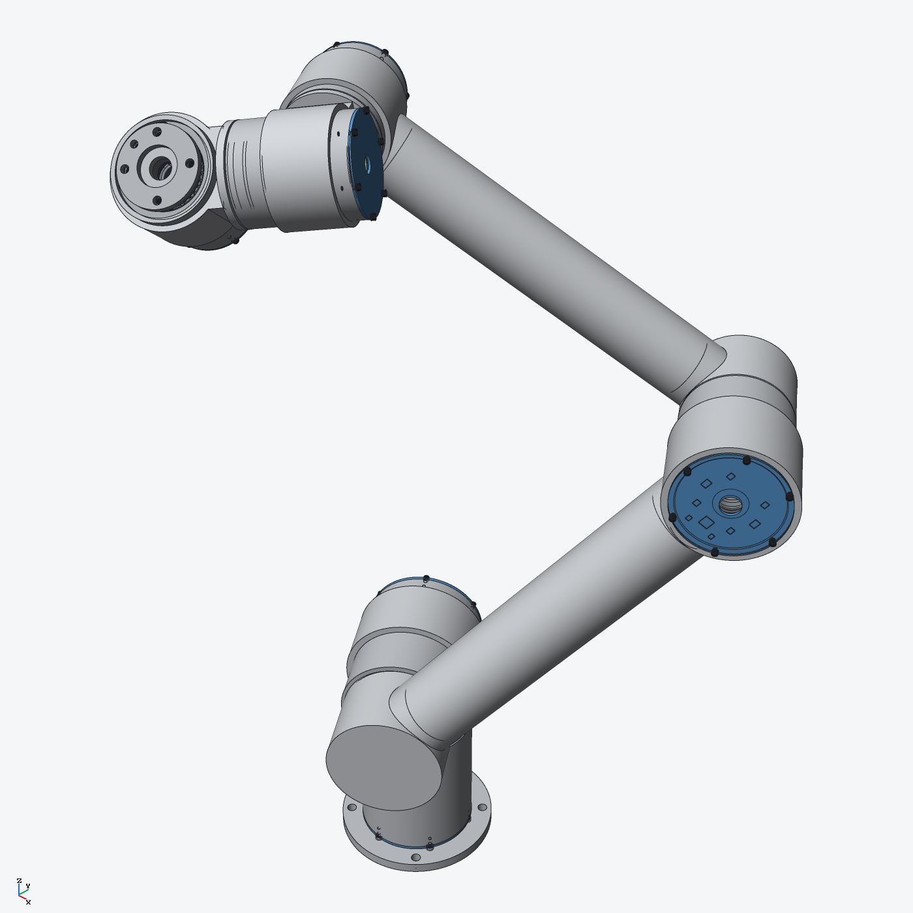 | 343 occurrences, strain-wave 80:1 joints, 1,703 pairs, 0 interferences |

## Mechanisms
| Model | Preview | Occurrences | Interference |
|---|---|---|---|
| [1" two-piece full-port ball valve](ball-valve/) | 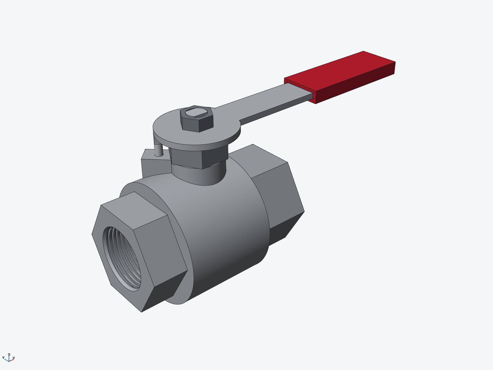 | 16 | 32 pairs, 0 interferences (at valve=0 deg and valve=90 deg) |
| [100 mm (4") machinist's milling vise](bench-vise/) | 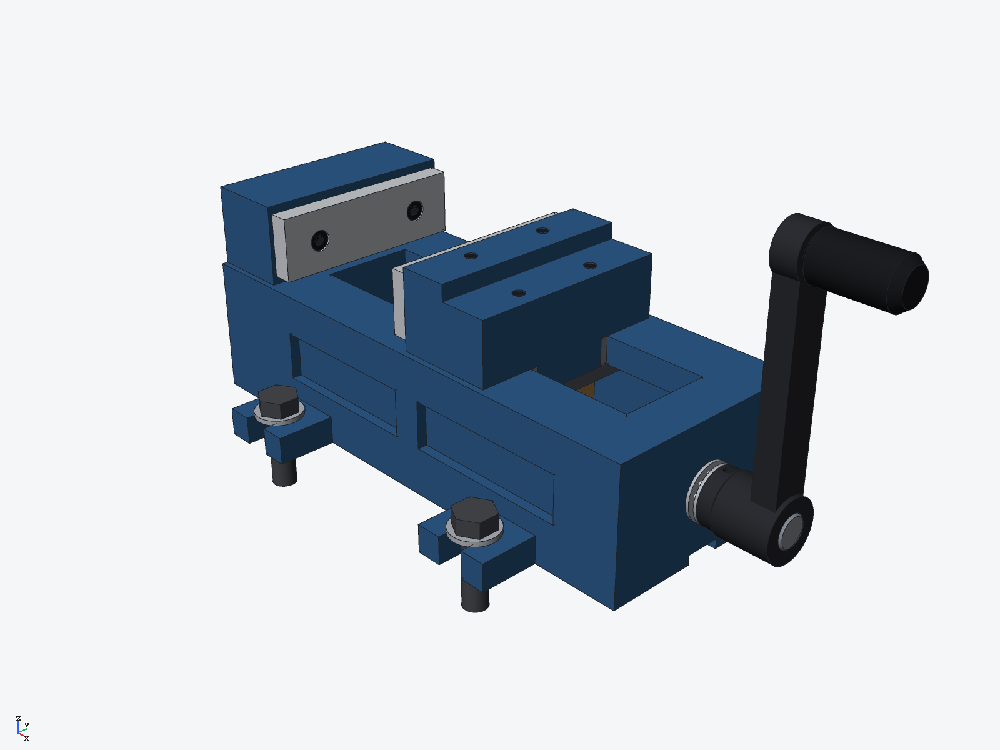 | 42 | 93 pairs, 0 interferences (0 touching, 0 unchecked) at opening 20 mm and 80 mm |
| [Cycloidal drive, 11:1, 90 mm](cycloidal-drive/) | 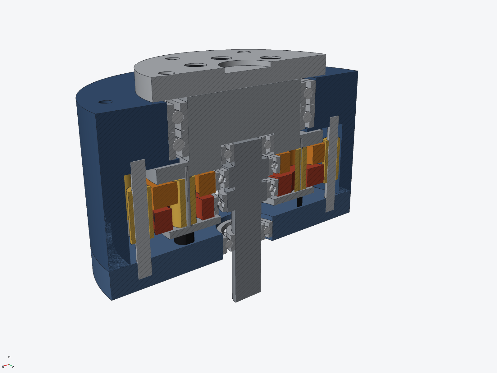 | 80 | 337 pairs, 0 interferences (also 0 at input 0° / 304 pairs and 132° / 353 pairs) |
| [4-module DIN-rail controller enclosure](din-enclosure/) | 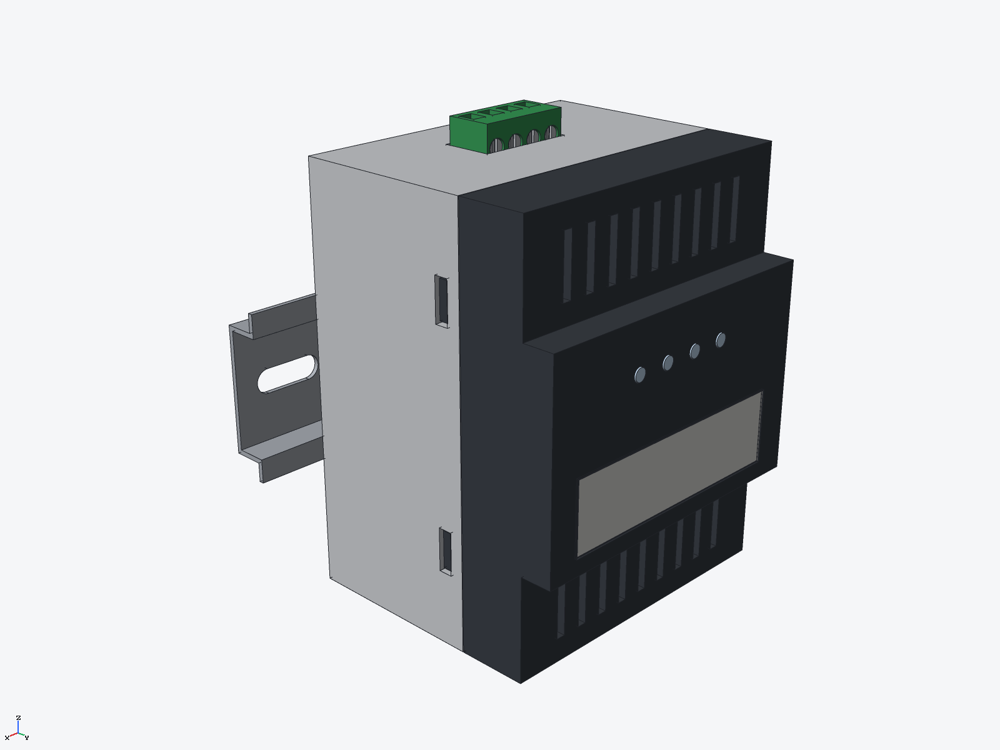 | 27 | 54 pairs, 0 interferences (latch=0 mm); 53 pairs, 0 interferences (latch=6 mm) |
| [External spur-gear hydraulic pump (Group-1 size)](gear-pump/) | 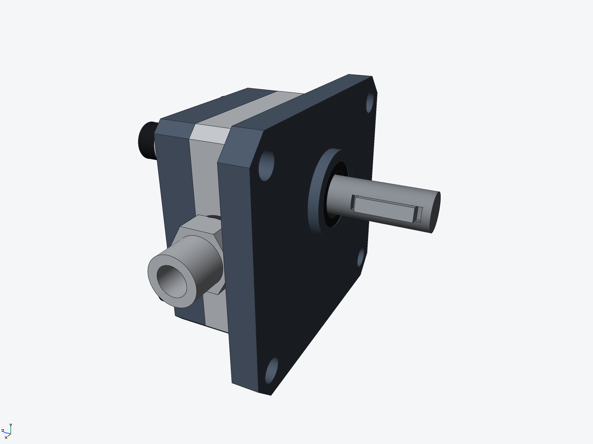 | 30 | 84 pairs at theta=0 deg and 82 pairs at theta=10 deg, 0 interferences |
| [Lead-screw linear stage, 200 mm travel](linear-stage/) | 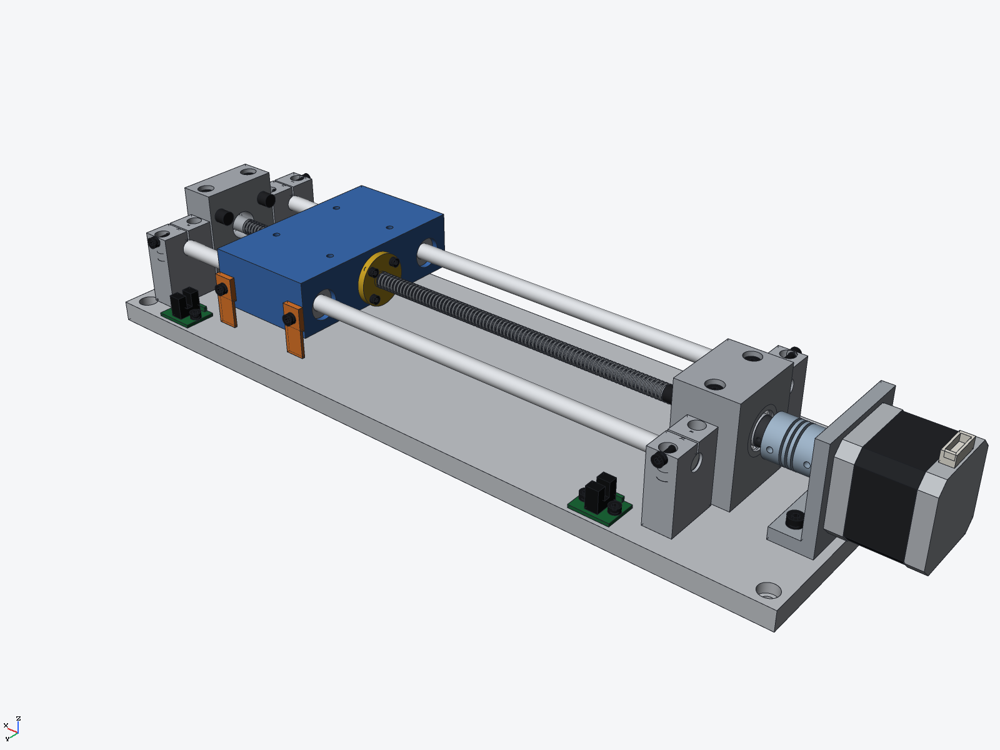 | 78 | 156 pairs, 0 interferences (travel 30 mm and 170 mm; also 0 at 0 mm and 200 mm) |
| [Pillow-block drive line](pillow-drivetrain/) | 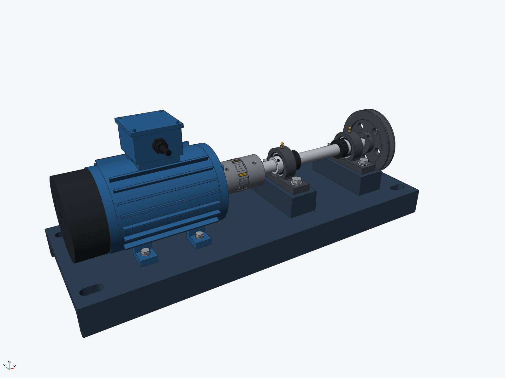 | 63 | 163 pairs, 0 interferences (at shaft = 35 deg; also 0 at 0 deg/143 pairs and 120 deg/165 pairs) |
| [NEMA 17 Planetary Gearbox, 5:1](planetary-gearbox/) | 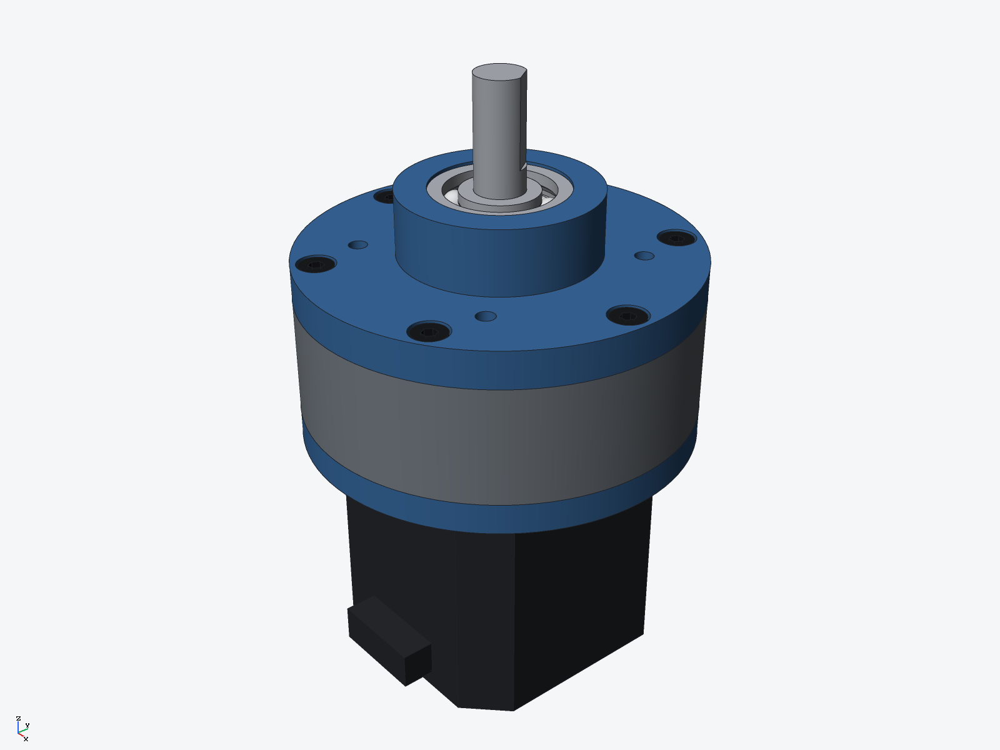 | 39 | 109 pairs at out = 0 deg and 123 pairs at out = 36 deg, 0 interferences |
| [ISO 15552-style tie-rod pneumatic cylinder, 32 x 100](pneumatic-cylinder/) | 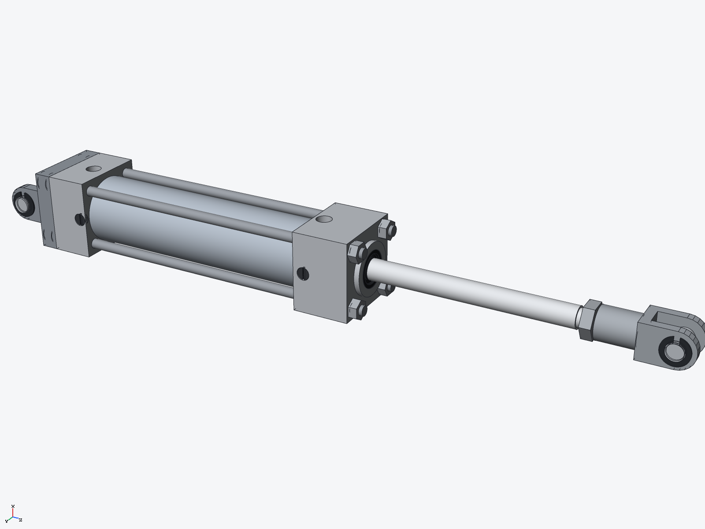 | 35 | 85 pairs, 0 interferences (stroke 10, 90 and 100 mm; 88 pairs, 0 interferences at 0 mm) |
| [Horizontal hold-down toggle clamp](toggle-clamp/) | 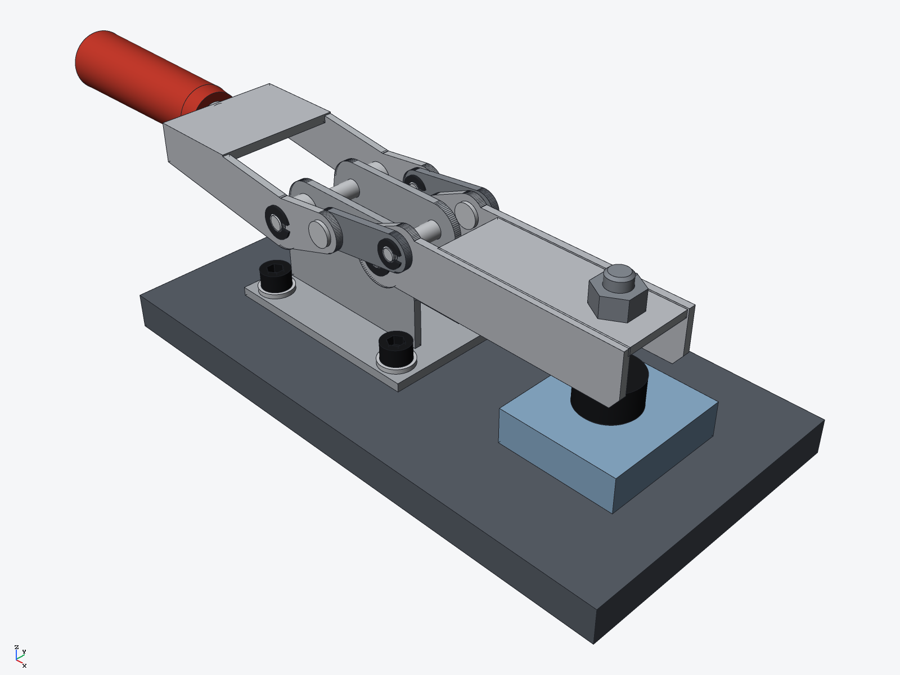 | 34 | 68 pairs clamped + 91 pairs open, 0 interferences |

## Also
- [Chess set](chess/): a full set of pieces and a board.
- [Impeller](impeller/): 7-blade swept impeller.

## Move one
    ryucad param set ball-valve "valve=90 deg"
    ryucad assembly solve ball-valve
