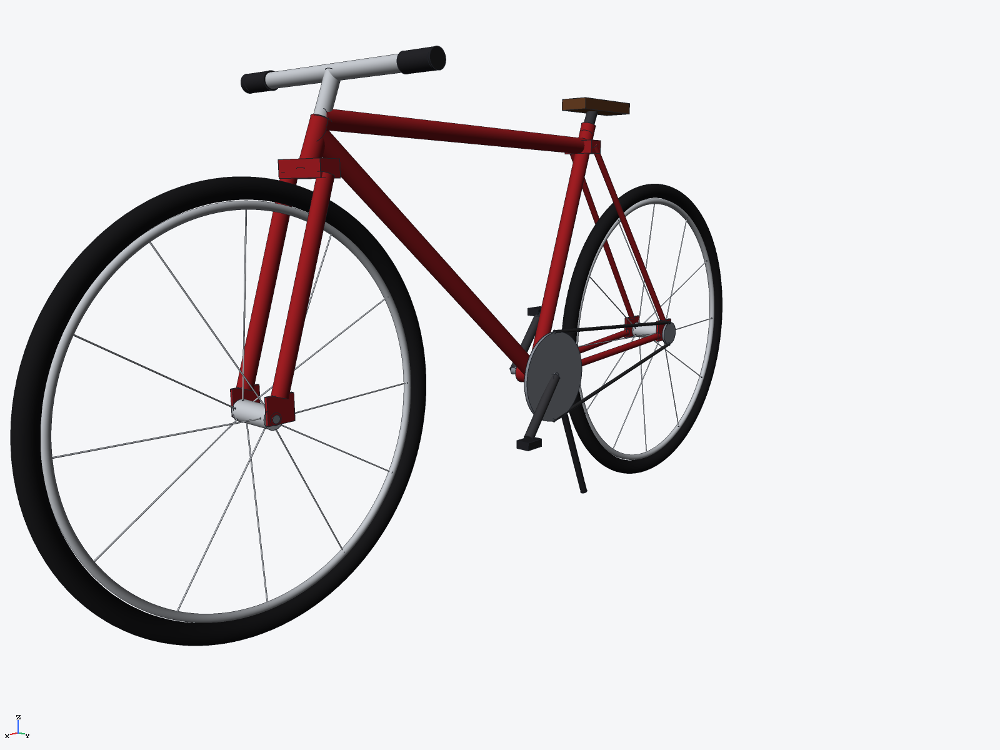
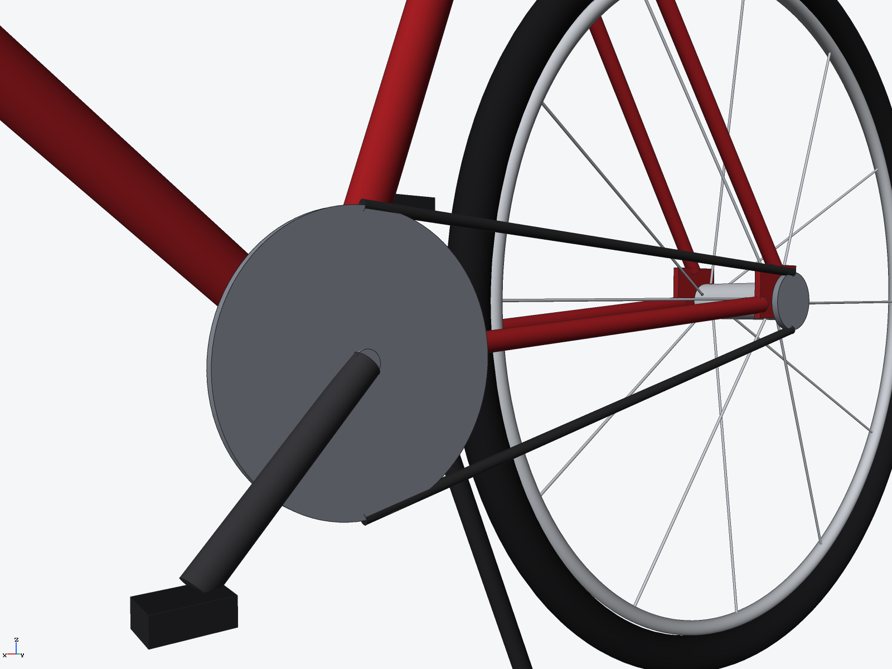

# Road bicycle (ryucad 0.9.0)

A diamond-frame road bicycle built entirely through the ryucad CLI by
`tools/bicycle.py`: a candy-red frame with a full tube set, two spoked
wheels, and a chain drive laid out on a realistic chainline. Proportions
follow a real 700c road bike; it is a static solid model, not a rider.

## Parts

- **Frame** (one part, 39 solids, modelled in place in world coordinates):
  down, top and seat tubes, head tube, seat and chain stays, fork blades
  and crown, and dropout plates, all candy red `#a41f24`; silver stem and
  straight handlebar with black grips; dark seat post with a brown saddle;
  steel chainring and rear cog, bottom-bracket axle, angled cranks and
  pedals; two straight chain runs; black kickstand
- **Wheel** ×2: silver rim torus and hub barrel with a bored axle hole,
  12 spokes laced alternately to the two hub flanges
- **Tyre** ×2: black rubber torus, outer radius 322 mm

Key dimensions: wheelbase 1030 mm, wheels Ø644 mm, overall
1674 mm long × ~805 mm high, bottom bracket 288 mm above the ground.
Chainring Ø168 mm, rear cog Ø48 mm, chain runs at y = +47 mm.

## Verified

- `ryucad check`: 0 errors, 0 warnings (the project folder sits inside a
  git repo whose git-driver warnings are repo setup, not model findings)
- `ryucad doctor`: healthy
- `ryucad interference bicycle`: 27 pairs, 0 interferences, 0 touching
  (mesh estimate)
- `ryucad bom bicycle`: 5 occurrences, 3 BOM lines; mass 12.259 kg at
  solid material densities
- STEP AP242 export: `export/bicycle.step`

## Not verified / simplifications

- No mates or motion: the wheels do not spin and the cranks do not turn;
  every instance is fixed
- Frame tubes are solid cylinders, not hollow or butted, and the mass
  uses solid densities throughout — 12.259 kg is the solid-model mass,
  not a prediction for a built bike
- Chainring and cog are plain discs without teeth; the chain is two
  straight round runs, not individual links
- The tyre is a solid rubber torus: no tube, valve or tread
- Fork and stay tips stop short of the hub barrels and are bridged by
  dropout plates; nothing clamps the axles
- No structural, load or aerodynamic analysis
