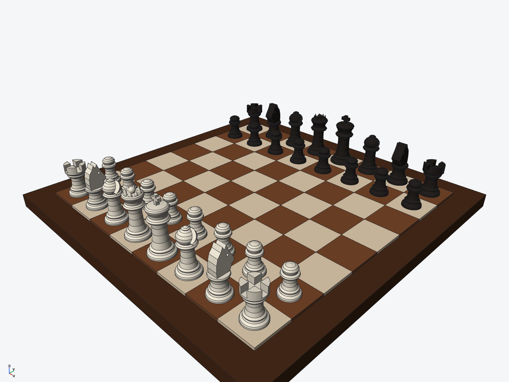

# Staunton chess set — ivory and ebony (ryucad 0.9.0)

A Staunton-style chess set in starting position, built entirely through the ryucad CLI by
`tools/chess.py` (250 commands). The pieces are revolved lathe profiles; the board is a
single part of 65 solids; the two armies are one set of six piece parts coloured per
assembly occurrence, ivory against ebony.

## Parts (7 BOM lines, 33 occurrences)
- Board: mahogany base (392 x 392 x 16 mm) plus 64 separate square solids (42 mm),
  coloured per solid, maple `#e8d5b5` on light squares, walnut `#7a4a2b` on dark
- Pawn (x16), rook (x4), knight (x4), bishop (x4), queen (x2), king (x2) — one part
  per type, instanced for both armies and coloured per occurrence
  (ivory `#f2ead8` / ebony `#26221f`)

## Key dimensions
- Squares 42 mm; king 64 mm tall on a 30 mm base, queen 55.6 mm, pawn 32 mm
- Total mass 1.97 kg (boxwood at 670 kg/m^3 for all pieces, walnut board)
- Queens on their colour: the white queen stands on the light d1 square

Piece details are separate features on the revolved bodies: the rook's battlements are
two crossed slot cuts, the bishop's mitre a diagonal slot cut, the queen's coronet eight
cone points with a sphere finial, the king a cross. The knight's head is a horse-head
silhouette (muzzle, ears, mane) drawn in a yz sketch and extruded across the stem, with
a through-hole for the eyes; black knights are rotated 180 deg to face the white army.

## Verified
- `ryucad check`: ok, 0 errors, 0 warnings
- `ryucad doctor`: healthy
- `ryucad interference chess-set`: 82 pairs checked, 0 interferences (mesh estimate)
- STEP AP242 export: `export/chess-set.step`
- Exploded view `lift` (white army +70 mm, black +150 mm): `images/detail.png`

## Not verified / simplifications
- One boxwood density serves both armies; real ebony pieces would be denser
- Pieces are fixed instances on their squares, not mated; no mid-game poses
- The knight is a flat-sided extruded silhouette, not a carved head
- Turned profiles are polylines, so the curved surfaces are fine conical bands
- `ryucad check` run inside this repo also reports 4 warnings about the parent
  checkout's missing ryucad git drivers/hooks — a property of the repo, not the model
