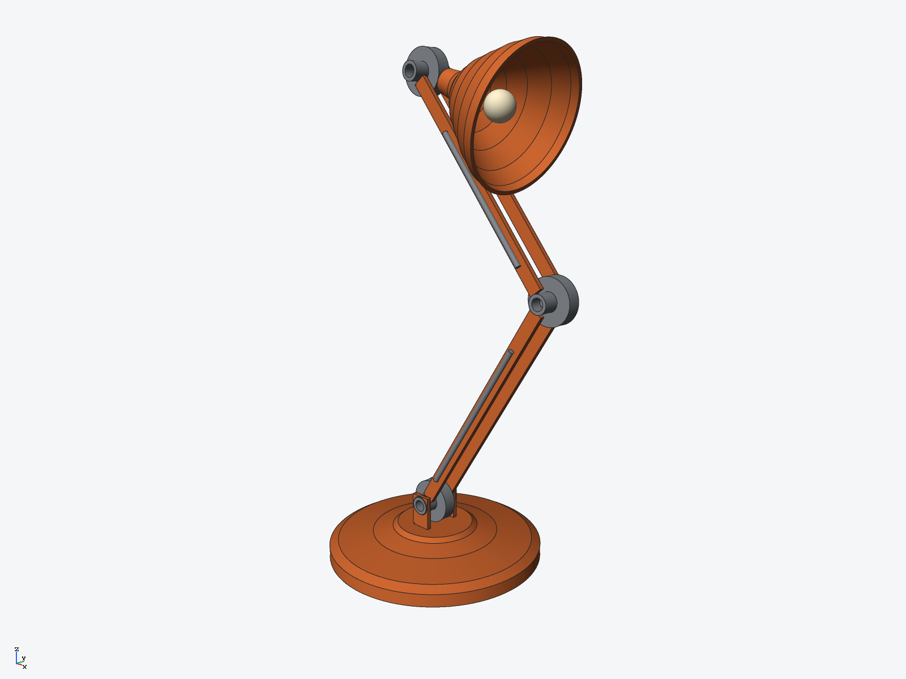

# Articulated desk lamp (ryucad 0.9.0)

An articulated architect's desk lamp in warm orange enamel, built entirely through the
ryucad CLI by `tools/desk-lamp.py` (67 commands). Anglepoise stance in the XZ plane with
every joint axis along Y: domed base, twin-bar arms, exposed springs, and a bell shade
aimed down-forward over the desk.

## Parts (7 BOM lines, 9 occurrences)
- Base: revolved dome (r85 foot, domed top) with a clevis pair bored r7.5 for the
  base joint's cap
- Joint (x3): one shared part — disc r17, through cap r7, centre bore r4.5
- Arm-lower (210 mm) and arm-upper (190 mm): twin bars with steel cross pins (r4)
  that run in the joint bores; bars stop 8 mm short of each joint centre so their
  ends clear the joint caps
- Springs: four steel rods (r2) alongside the arms at y = +/-15.5
- Shade: bell shell (2.5 mm wall, slim r9 neck) from two revolved profiles —
  outer solid, inner cut; bulb: a cream sphere r11 inside the bell

## Key dimensions
- Pose: base joint at z 44; lower arm 32 deg from vertical, elbow at (111, 222);
  upper arm leaning back at -38 deg, head joint at (-6, 372); shade aimed
  (0.94, 0, -0.34), 32 deg off the upper arm
- Overall height about 390 mm; total mass 1.617 kg, centre of mass (14.6, 0, 84.6) mm,
  well inside the base footprint

## Verified
- `ryucad check`: ok, 0 errors, 0 warnings
- `ryucad doctor`: healthy
- `ryucad interference desk-lamp`: 24 pairs checked, 0 interferences, 0 unchecked
  (mesh estimate)
- STEP AP242 export: `export/desk-lamp.step`
- Head close-up (bell interior, bulb, head joint): `images/detail.png`

## Not verified / simplifications
- The pose is fixed: joints are placed instances, not mates, and do not articulate
- Springs are smooth rods, not coils; no power cord is modelled
- The shade neck stands 4 mm off the head joint disc — an exactly tangent neck made
  that pair's interference boolean "uncertain", so the neck was backed off
- The bulb is a plain sphere: no socket, filament or wiring
- No tip-over or joint-strength analysis; the centre of mass is reported, not tested
- `ryucad check` run inside this repo also reports 4 warnings about the parent
  checkout's missing ryucad git drivers/hooks — a property of the repo, not the model
