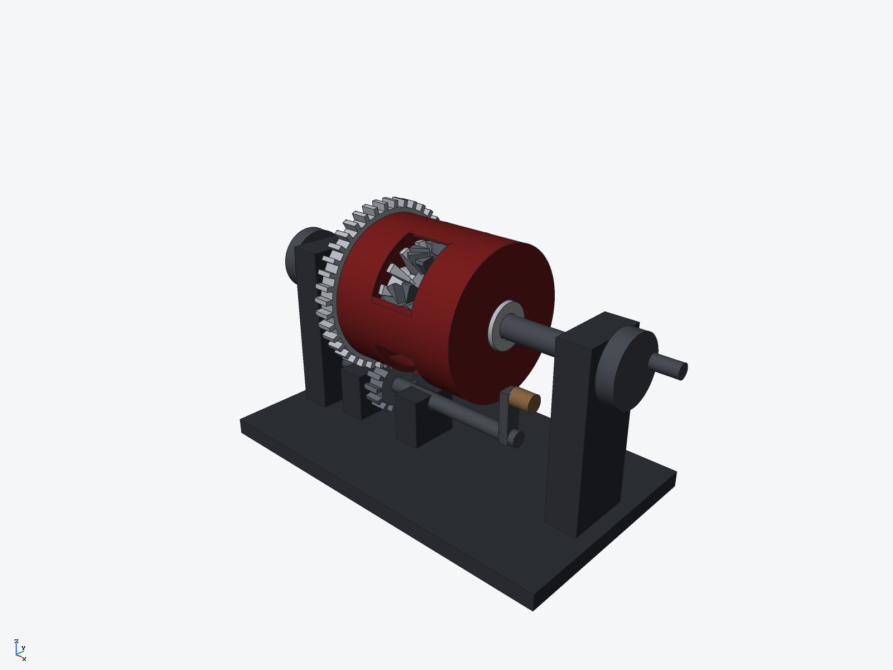
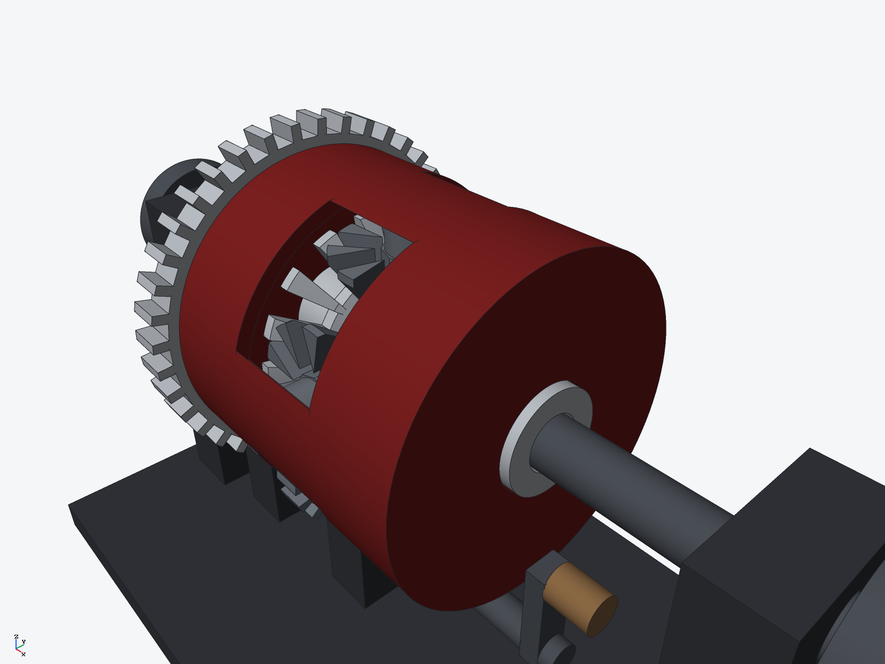

# Open differential — bevel-gear demonstrator (ryucad 0.9.0)

An open automotive-style differential built as a hand-turned bench
demonstrator: two straight bevel side gears and four bevel spider pinions
inside a windowed carrier drum, a bolted-on spur ring gear driven by a
layshaft pinion with a hand crank, and a hand wheel on each axle so the
differential action can be worked by hand. Built entirely through the ryucad
CLI by `tools/differential.py`. The checked pose is the assembled pose, all
gears phased tooth-into-gap: **check 0 errors, 0 warnings; 53 interference
pairs, 0 interfering, 0 touching.**

## Gearing

| member | teeth | geometry |
|---|---|---|
| side gears (2) | 16 | straight bevel, pitch cone half-angle 58 deg, module 3.0 at the outer cone, cone distance 28.3 mm |
| spider pinions (4) | 10 | straight bevel, pitch cone half-angle 32 deg (atan(10/16) for the 90 deg shaft angle), on a cross pin (Y and Z arms) |
| ring gear | 40 | spur, pitch r = 40 mm, bolted to the carrier cheek with 6 bolts |
| input pinion | 13 | spur, pitch r = 13 mm on the layshaft; final-drive ratio 40:13 = 3.08:1 |

Bevel teeth are tapered sector gap cuts into tip-cone revolved blanks:
tooth thickness tapers with cone distance, as on a real straight bevel
gear, and the gap floors sit below the root cone so mating teeth never
bottom out. Phasing is by tooth-count parity, set as fixed instance
rotations: side gears ±11.25 deg (half pitch), input pinion −6.92 deg.

## Parts (14 BOM lines, 14 occurrences)

- 2 bevel side gears (steel), 4 bevel pinions (steel), carrier drum with
  4 windows, cross pin and cheeks (steel, red), ring gear with 6 bolts
  (steel), input pinion (steel)
- 2 axle shafts with hand wheels, layshaft with crank arm, wooden crank
  grip, cast-iron base with two main pedestals and two layshaft pedestals

Running clearances (radial): axle r5.6 in side-gear bore r6 — 0.4 mm;
side-gear hub r11 in carrier cheek bore r11.4 — 0.4 mm; pinion bore r4.7
on cross pin r4.5 — 0.2 mm; layshaft r4 in pedestal bores r4.4 — 0.4 mm;
input pinion bore r4.2 on the layshaft — 0.2 mm; ring-gear bolts r2.5 in
cheek holes r3 — 0.5 mm.

Overall: base plate 190 x 110 mm, 222 mm across the hand-wheel grips,
118 mm tall; mass 3.44 kg.

## Caveats

Static pose only — the mesh is verified clash-free at the assembled phase,
not swept through rotation. Teeth are straight tapered teeth without an
involute/conjugate flank profile, with generous backlash (~2 mm at
mid-cone) so the demonstrator turns freely. Shafts are not keyed to the
side gears; no bushings, thrust washers, or separate carrier bearings are
modelled (the carrier locates on the side-gear hub journals). No torque or
load rating is computed — hand turning only.
