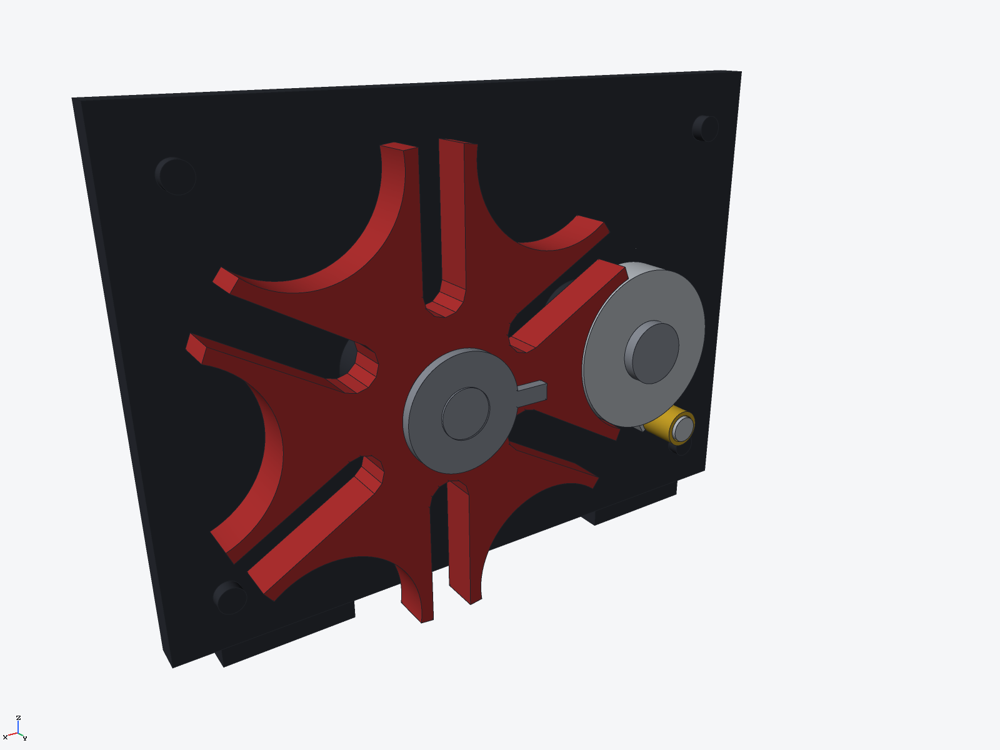

# Six-slot Geneva indexing mechanism (ryucad 0.9.0)

An external Geneva (Maltese cross) drive on a vertical demo backplate: one
revolution of the driver indexes the six-slot star wheel by exactly 60 deg and
locks it for the rest of the turn. Built entirely through the ryucad CLI by
`tools/geneva-mechanism.py`. The checked pose is the locked position.

## Geometry

Standard Geneva relations with centre distance a = 60 mm, n = 6 slots:

| quantity | relation | value |
|---|---|---|
| pin radius R | a·sin(pi/n) | 30.00 mm |
| star pitch radius | a·cos(pi/n) | 51.96 mm |
| engagement window | driver angle | ±60 deg |
| star rotation per index | 2pi/n | 60 deg |

- Driver: r = 21 mm locking disc on a hub, coplanar with the star; below the
  star plane a pin plate carries a r = 3.5 mm stud with a free brass roller
  (r = 5 mm, bore r = 3.8 mm) up through the slot band — the classic
  two-element driver, so the roller, not the disc, works the slots.
- Star: r = 56 mm blank, six radial slots 10.6 mm wide (0.3 mm clearance per
  side on the roller) and six concave locking notches of r = 21.6 mm — the
  r = 21 mm disc sits in a notch with 0.6 mm clearance at lock. The notch
  leaves a 3.1 mm wall to the neighbouring slot at its thinnest.
- Slot length was settled by a 2D sweep of the roller through the whole
  engagement (star following the exact Geneva relation, driver −60..+60 deg,
  sampled every 0.1 deg): with capsule end centres at radii 25 and 57 mm the
  minimum roller-to-star clearance is **0.30 mm** at every engaged angle.
  A slot inner end at radius 33 mm — the first sketch — provably jams: the
  pin centre reaches radius 30 mm from the star centre at mid-engagement,
  inside the roller's reach of that slot end.

## Verified

- `ryucad check`: 0 errors, 0 warnings.
- `ryucad interference`: 9 pairs checked, **0 interferences**, 0 touching.
- Shafts run in r = 6.4 mm bores on r = 6 mm shafts (0.4 mm radial
  clearance); the roller has 0.3 mm on its stud; the pin plate clears the
  backplate bosses by 0.3 mm and the star plane by 0.3 mm.
- Mass 2.87 kg (steel star/driver, cast-iron plate, brass roller).

## Parts (6 BOM lines, 6 occurrences)

- Backplate 180 × 130 × 8 mm with two bearing bosses and two feet
- Driver (hub, locking disc, pin plate, stud), driver shaft with rear crank
  and wood grip, brass roller
- Star wheel, star shaft with index pointer disc

## Not verified

- The CAD pose is static (locked, pin at 120 deg). Motion was verified only
  by the 2D roller/slot sweep above — the locking disc's clearance to the
  star through the rotation was not swept in 3D, and no mates or parameters
  drive the model.
- Slot ends and locking arcs are polygon/cylinder approximations of the
  true Geneva curves; no dynamic load, wear or backlash analysis.
- The crank, grip and pointer are demonstrator furniture, not a designed
  drive train; no torque rating is claimed.
