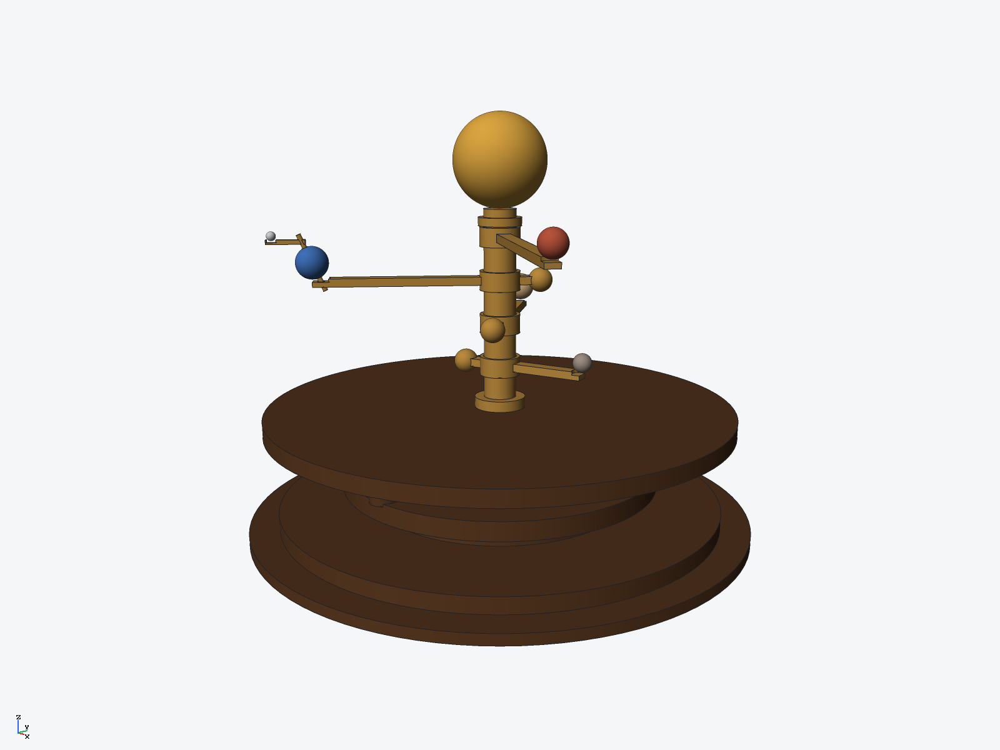
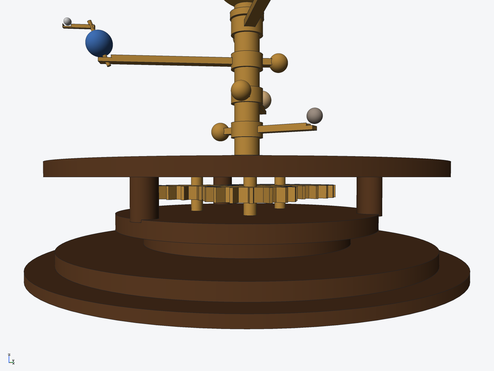

# Brass orrery — Sun, Mercury, Venus, Earth & Mars (ryucad 0.9.0)

A brass-and-walnut table orrery: a gold Sun on a central column, four planets on staggered
brass arms over a walnut drum, and three exposed drive gears meshing under the top plate.
Built entirely through the ryucad CLI by `tools/orrery.py`. It is a static display model:
**nothing rotates — no mates, drive or gear train was solved.**

## Parts (15 BOM lines, 16 occurrences)
- Base (walnut, one revolved part): foot r=95, stepped pedestal, flange at z=17..24, three
  posts at r=56, top plate r=88 at z=40..46 — an open drum, so the gears show in the band
- 3 drive gears (brass): one 24T (pitch r=26) meshing two 16T (pitch r=18), flat at
  z=30..36 on arbors spanning flange to plate; the 16T part is placed twice
- Central column (brass, r=6, z=46..120) and Sun (gold sphere r=17, centre z=137)
- 4 planet arms (brass, one part each): bar + bored hub + counterweight ball, at
  z=62 / 78 / 94 / 110 so the arms pass over each other
- 4 planets (separate spheres, own colours): Mercury r=3.5, Venus r=5.5, Earth r=6, Mars r=4.5,
  each seated in a cup (r = planet + 0.3) cut into its arm tip
- Earth extras (brass): axis rod tilted 23.5 deg through Earth — Earth is bored r=1.2
  and the arm drilled r=1.2 along the rod line — plus the moon arm;
  Moon (grey sphere r=1.7) seated in an r=1.9 cup on the arm tip

Key dimensions: overall 190 mm diameter x 154 mm tall (Sun top); orbit radii
34 / 50 / 68 / 84 mm; gear centre distances 43.6 / 43.6 / 35.6 mm; mass 1.07 kg
(ryucad `mass`, densities set for every part).

## Gears
The brief's first sketch — centres on a triangle of radius 40, pitch radii 26/18/18 —
cannot mesh: that triangle's side is 69.3 mm but the pitch sums are 44/36. The centres
therefore sit on the triangle whose sides *are* the pitch sums minus 0.4 mm clearance
(43.6 / 43.6 / 35.6, circumradius 23.9 mm). Teeth are single polygon outlines
(root rp-2.6, tip rp+1.8), phased tooth-into-gap at every mesh; the three phase
conditions are not exactly commensurate, so each gear splits the difference between
its two meshes (worst misalignment 2.2 deg on the 24T gear, inside the gap clearance).
The base is an open drum rather than a solid column at gear level because the meshing
discs' union reaches the axis and would swallow any central post there.

## Rebuild
    python3 -I tools/orrery.py $(which ryucad) <empty folder>

## Verified
- `ryucad check`: 0 errors, 0 warnings in the standalone build (this repo folder adds
  only the 3 git driver/hook warnings the sibling projects in this repo share)
- `ryucad interference orrery`: 18 pairs checked, **0 interfering** (mesh estimate) —
  a clearance pass replaced the first build's 5 sunk seatings (~53 mm^3) with fitted
  clearances: planet cups in the arm tips, an r=1.2 bore through Earth and a drilled
  hole through its arm for the axis rod, and a cupped moon seat. The three gear
  meshes remain clear; gear geometry and phasing untouched.
- `ryucad bom`, `ryucad mass` (1.07 kg), STEP AP242 export (`export/orrery.step`)
- Renders inspected: colours, seating and the gear band all read correctly

## Not verified / simplifications
- Static model: arms and gears are fixed instances; the 24:16 gear pairing is not a real
  orrery train and no drive connects the gears to the arms
- Planet sizes, orbit radii and arm heights are representative, not to scale; planet
  densities are the real planets' (the Sun is modelled as solid gold, 19 300 kg/m^3)
- No winding key, fasteners or threads modelled; gear teeth are trapezoids without
  involute flanks, root fillets or tip relief
