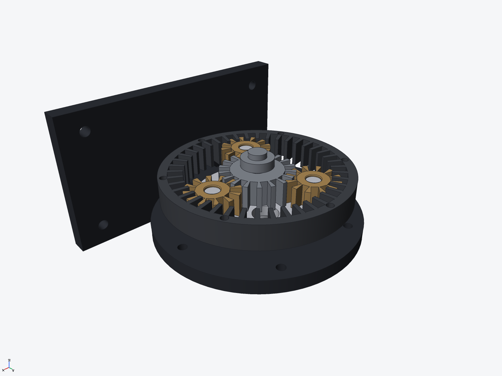

# Planetary gearbox desk model (ryucad 0.9.0)

A planetary gearbox desk model built entirely through the ryucad CLI by
`tools/planetary.py` (147 commands): an 18-tooth steel sun drives three 12-tooth bronze
planets on an aluminium carrier inside a fixed 42-tooth cast-iron ring gear
(18 + 2 x 12 = 42, so the geometry closes), turned by a crank handle from below and
mounted on a cast-iron stand. Rebuilt with ryucad 0.9.0; results match the original
0.8.3 build (mass identical to the gram).

## Parts (8 BOM lines, 8 occurrences)
- Sun gear, 18T, steel; 3 planet gears, 12T, bronze (separate parts, phased per position)
- Ring gear, 42T internal, cast iron, bolted to the stand
- Carrier, aluminium: plate, hub and three planet pins
- Input shaft with crank arm, handle and grip, steel
- Stand, cast iron (darkened `#2e3138`): foot plate, column and back plate

## Key dimensions
- Pitch radii: sun 18 mm, planets 12 mm, ring 42 mm; gear face widths 12-14 mm
- Total mass 2.080 kg, volume 298,902 mm^3, centre of mass (0.16, -33.91, -4.03) mm
- Ring fixed, so the sun-to-carrier ratio is 1 + 42/18 = 3.33 : 1 (kinematics not simulated)

Gears are sketched discs with one trapezoid tooth gap cut and patterned round; phasing is
tooth-into-gap at every mesh (sun gaps and ring gaps at 0/120/240 deg, each planet phased
with a tooth toward the sun and, 180 deg on, a tooth into the ring's gap). Mates: sun
fastened to the input shaft, ring fastened to the stand, input shaft on a solved revolute
in the stand bore. The three planet revolute mates are refused by the solver
(`assembly_overconstrained`) because the planets are fixed instances — they are placed at
their computed centres instead, exactly as in the 0.8.3 build.

## Verified
- `ryucad check`: ok, 0 errors, 8 warnings — all `instances_interfere` point contacts
  of at most 3.6e-10 m^3 at the tooth meshes and pin/bore touches (mesh residuals at
  contact, the same readings as the 0.8.3 build)
- `ryucad doctor`: healthy
- `ryucad interference planetary`: 23 pairs, 15 clear, 8 mesh-estimate contacts
  <= 3.6e-10 m^3 (point contact, not real overlap)
- STEP AP242 export: `export/planetary-gearbox-desk.step`
- Exploded view `apart`: `images/detail.png`

## Not verified / simplifications
- Gear teeth are trapezoid approximations, not involute profiles; no backlash or
  load analysis, and the 3.33 : 1 ratio is from the tooth counts, not a solved motion
- Planet gears are fixed instances: their revolute mates on the carrier pins are
  refused (assembly_overconstrained) while the instance is fixed
- Contact volumes are mesh estimates and read as tiny signed noise on touching faces;
  `check`'s exact numbers are the ones quoted above
- `ryucad check` run inside this repo also reports 4 warnings about the parent
  checkout's missing ryucad git drivers/hooks — a property of the repo, not the model
