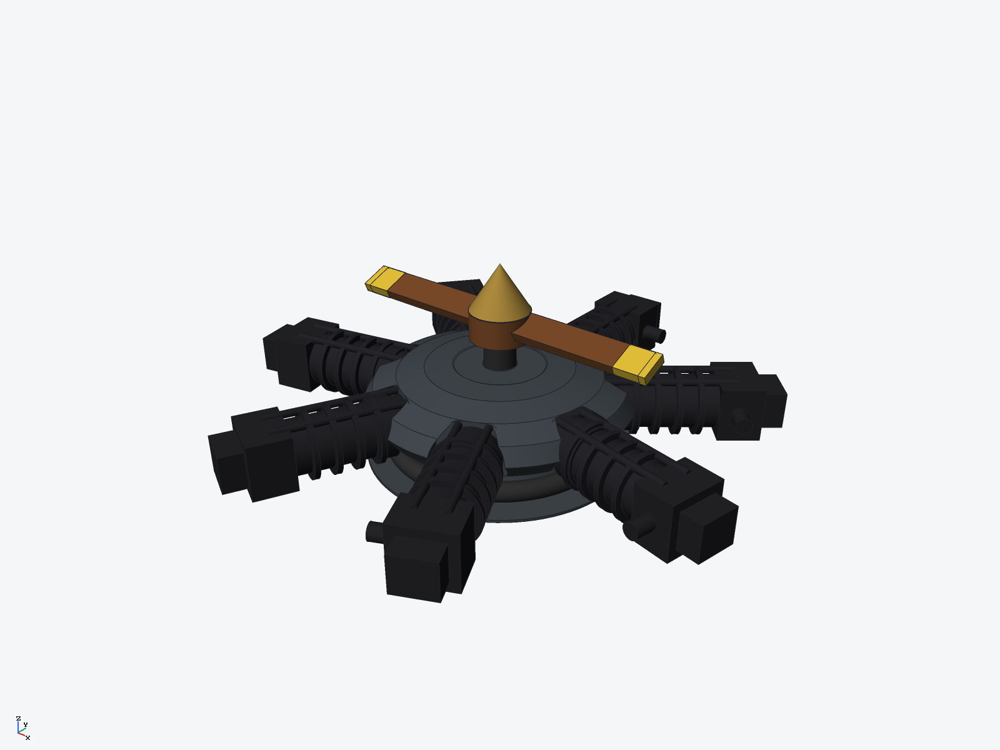
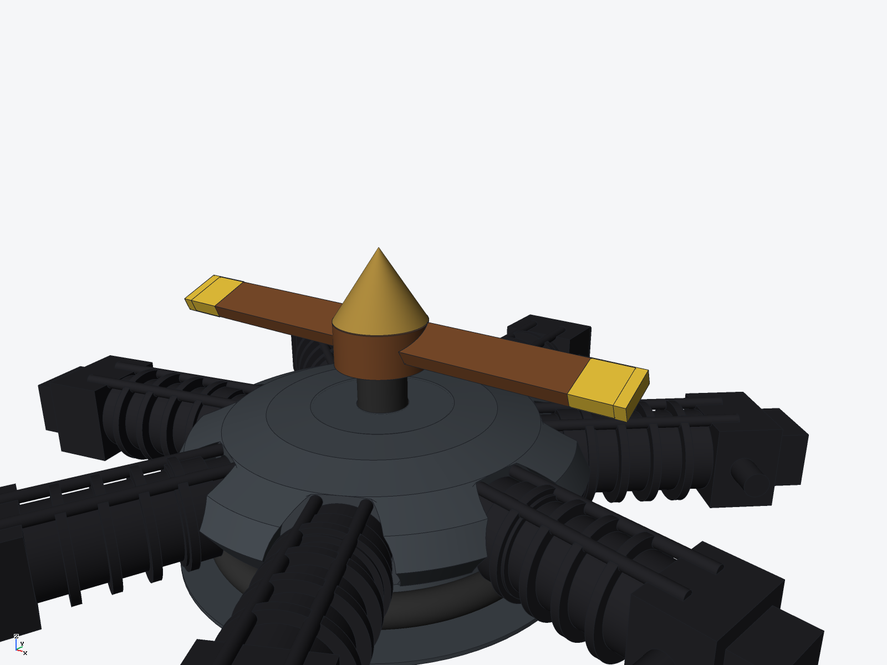

# 7-cylinder radial aircraft engine (ryucad 0.9.0)

A seven-cylinder air-cooled radial aircraft engine: finned cylinders in the XY plane
around a revolved crankcase, crank axis on Z, two-blade propeller and brass spinner at
the front (+Z), exhaust collector ring at the rear. Built entirely through the ryucad
CLI by `tools/radial-engine.py`. Proportions are illustrative: **no power, thrust,
torque or cooling performance was computed.**

## Parts (6 BOM lines, 12 occurrences)
- Crankcase — revolved profile about Z (rear flange r 58 at z −22, step at
  z −20.9, slim rear neck so the collector ring runs clear, main case r 58,
  front cover closing at z +18), with a stepped counterbore socket
  (r 15.5 over r 11.9) cut for each cylinder, a front shaft bore r 7.3 and an
  internal counterweight cavity r 19.5; dark aluminium
- Cylinder ×7 — one part instanced at 51.4286° spacing, one pointing straight up (+Y):
  barrel r 11.5 (y 38..92) seated in its socket with 0.4 mm clearance, base
  flange ring r 13 at radial 50..59, 4 cooling-fin discs
  r 14.5, head block 26 × 18 × 24 with rocker box, 2 pushrod tubes, exhaust stub;
  cast iron, near-black
- Crankshaft — shaft r 7 (z 10..34) with counterweight disc (z 11..17) turning
  in its case cavity, steel
- Propeller — one part: hub r 13 (z 30..42), bored r 7.3 over the shaft, with
  two walnut blades pitched 22°, yellow tips as separate solids
- Spinner — brass cone, r 13 at z 42.3 tapering to a point at z 62.3
- Exhaust collector ring — torus, tube r 4.2 on a r 46 circle at z −16, dark steel

Key dimensions: 240 mm across opposite rocker boxes, propeller Ø 146 mm,
overall depth 84.3 mm (z −22..+62.3), crankcase Ø 116 mm. Mass 2.87 kg from
`ryucad mass` at the modelled densities (aluminium 2700, cast iron 7200,
steel 7850, brass 8500, walnut 640 kg/m³) — a styling-scale figure, not an
engine weight.

## Rebuild
    python3 -I tools/radial-engine.py $(which ryucad) <empty folder>

## Verified
- `ryucad check`: passed, 0 errors, 0 warnings in the standalone build
  (this repo folder adds only the 3 clone-level git driver/hook warnings —
  `ryucad git install` not run; the same 3 appear for every project in this
  clone, and the standalone build's `doctor` is fully healthy)
- `ryucad interference radial-engine`: 28 pairs checked, **0 interfering**
  (mesh estimate) — a clearance pass replaced the first build's 18 rooted /
  tangent joints with fitted clearances: counterbore sockets for the
  cylinders, a bored shaft seat and counterweight cavity, a bored prop hub,
  and a slimmed collector-ring tube (see facts.json)
- `ryucad bom`, `ryucad mass` (2.87 kg), STEP AP242 export (`export/radial-engine.step`)

## Not verified / simplifications
- No internals beyond the counterweight disc in its cavity: no pistons,
  connecting rods, valves, intake pipes or crank webs; the case sockets and
  cavity are clearance features, not a full internal architecture
- Exhaust stubs do not connect to the collector ring; no downpipes modelled
- Propeller pitch is a visual 22° tilt of both blades; no thrust or balance
  analysis beyond the symmetric mass properties
- No fasteners or threads; heads are blocks and cooling fins are plain discs
