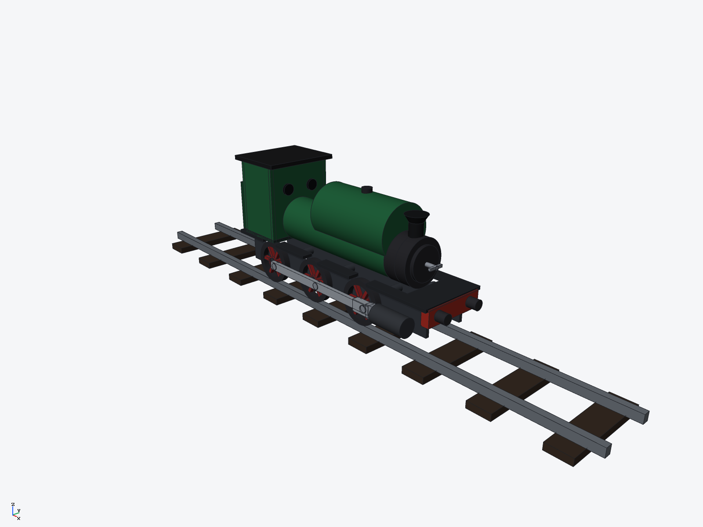
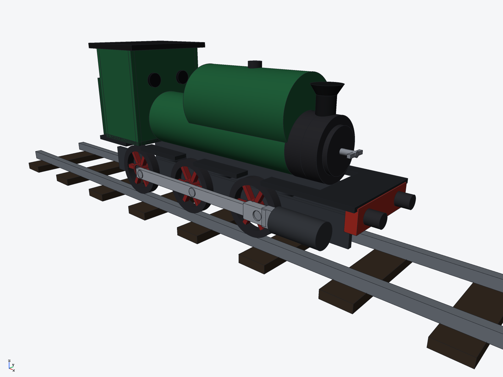

# 0-6-0 saddle-tank steam locomotive (ryucad 0.9.0)

A small 0-6-0 saddle-tank shunter — green boiler and saddle tank, black smokebox and
cab roof, red spoked coupled wheels — standing on a short section of track. Built
entirely through the ryucad CLI by `tools/steam-locomotive.py`; every part is a fixed
instance, with the motion posed in one static phase. **No steam circuit, strength or
running behaviour was computed.**

## Parts

- **track** — two steel rails (700 mm long, centres at y ±33, tops at z 0) on nine
  timber sleepers
- **frames** — two side plates (inboard at y ±26), red buffer beam with two
  buffers, running board with a boiler channel and an arch over each wheel,
  three axles
- **boiler** — barrel with black smokebox, door and dart handle, flared chimney
  (at x 108, forward on the smokebox so its cap clears the tank), brass safety
  valve; no steam dome — see the notes below
- **tank** — the saddle tank: a cylinder whose underside is cut with an r 28
  cylinder about the boiler axis, so it hangs over the boiler with a uniform
  gap (1.0 mm off the barrel, 0.5 mm off the smokebox), with a filler cap
- **cab** — side walls, front sheet with two spectacle discs, black roof, rear
  bunker with a coal load
- **wheel** (×6) — one spoked wheel: bored-out tyre ring, hub bored r 5.4 for
  its axle, six spokes starting at radius 6 (clear of the axle), and a crank
  pin, coloured per solid (dark tyre, red spokes and hub)
- **motion** — coupling rods, piston cylinders, crossheads, piston rods and
  connecting-rod links, all in the outboard plane y ±43 (clear of the wheel
  faces); the rods ride on the crank pins through eyes bored r 4.4

Key dimensions: drivers Ø52 mm on axles at x 65 / −15 / −95 (wheelbase 160 mm),
wheel centres at z 26 on the rail top; boiler barrel Ø54 × 190 mm at z 78; saddle
tank Ø66 × 115 mm; loco 335 mm over the running board and buffers, roof top at
z 152.5 mm; track gauge 66 mm between rail centres. Crank pins all sit in phase,
14 mm ahead of their axles at axle height, and the coupling rods are centred on
the pin span (−81 / −1 / 79). Mass as modelled: 12.57 kg (solid parts; see caveats).

## Rebuild

    python3 -I tools/steam-locomotive.py $(which ryucad) <empty folder>

## Verified

- `ryucad check`: 0 errors, 0 warnings in the standalone build (this repo folder
  adds only the clone-level git driver/hook warnings every model here shows)
- `ryucad interference`: 75 pairs checked, **0 interfering** — every joint is a
  fitted clearance now (the first build had 141 interfering pairs of modelled
  overlaps; see facts.json for the pass)
- `ryucad doctor`: healthy in the standalone build; in this repo folder it shows
  only the clone-level git driver/hook warnings every model here shows
- `ryucad bom`: 7 lines, 12 occurrences; STEP AP242 export in `export/`

## Not verified / simplifications

- The motion is static: wheels, rods and crossheads are fixed in one phase; there
  is no valve gear and no kinematic or running check. The fitted clearances
  (0.3–2.5 mm) are nominal gaps at this pose, not swept through a revolution
- The steam dome was removed in the clearance pass: as dimensioned it lay
  entirely inside the saddle tank and the barrel, intersecting both, and none
  of it was visible; spectacle windows are dark discs, not openings; parts are
  solid, not hollowed
- Mass uses one material per part, so the brass safety valve, coal and sleepers
  carry their part's steel/cast-iron mass

