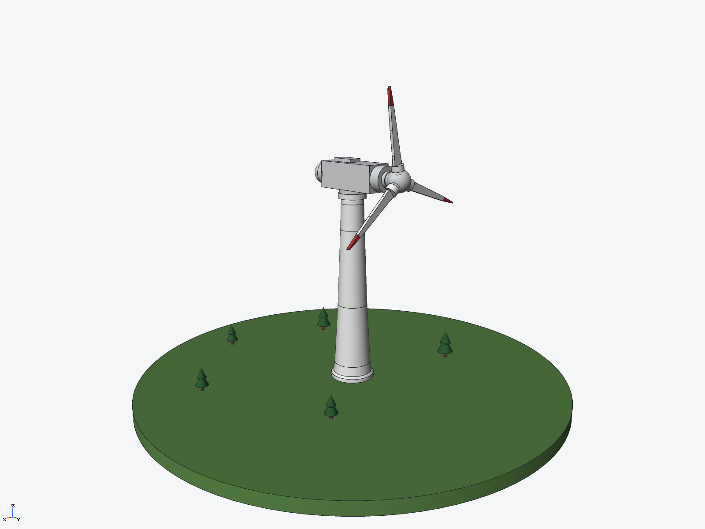
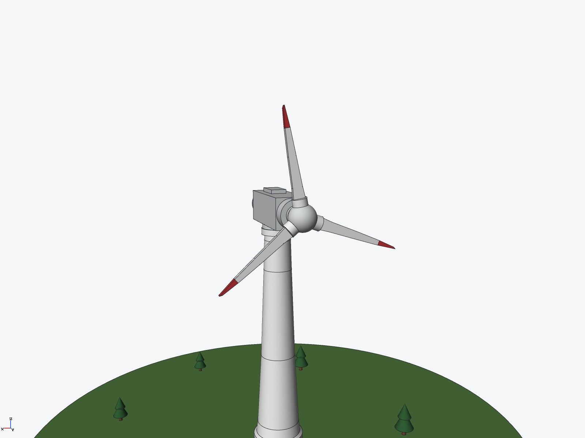

# Three-blade wind turbine (ryucad 0.9.0)

A modern three-blade wind turbine on a grass hill disc, built entirely through the
ryucad CLI by `tools/wind-turbine.py`. A display model: no loads, power curve or
aerodynamics were computed.

## Parts
- Ground: grass-green hill disc, r=170 mm, top at z=0
- Tower: revolved taper, base r=15 mm to r=8.5 mm at the top, flange rings at both
  ends, 148 mm tall, painted steel white
- Nacelle: one part pointing +Y (body, nose, rounded tail, yaw drum), light grey
- Hub: sphere spinner with a shaft that runs in a bored socket in the nacelle nose
- Blade x3: silhouette extrusion, 64.5 mm long, red tip as a separate solid; roots
  sit in sockets in the hub with 0.1 mm clearance
- Trees x5: trunk plus two stacked cones, in two sizes

Key dimensions: rotor centre at (0, 47.5, 161) mm, rotor diameter 129 mm, overall
height 224.5 mm (blade at 10 deg). Assembly mass 1.82 kg with the assigned material
densities (the solid steel tower dominates; a real tower is a shell).

## Verified
- `ryucad check`: 0 errors, 0 warnings; `ryucad doctor`: healthy
- `ryucad interference wind-turbine`: 16 pairs, 0 interferences, 0 touching
- STEP AP242 export in `export/`

## Not verified / simplifications
- Static display pose only; the rotor does not spin and there are no mates —
  every instance is fixed. Joints that look bolted (blade roots, hub shaft,
  tower/nacelle) are clearance or face-contact fits, never overlaps
- Blade outline is a flat extrusion (2.2 mm thick, no twist or airfoil section)
- Mass uses solid-material densities, so it is a property of the model, not of
  a real turbine
